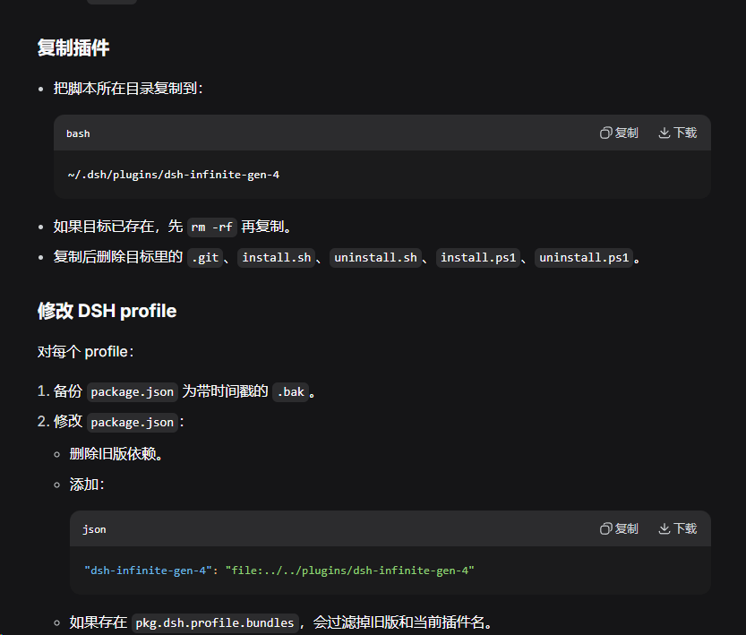

用父插件让插件在注册时只注册一个在列表，其他内容注册进子插件列表中
我希望文件中根据插件功能分文件夹例如main/plugin-open-folder,main/preset-bridge,main/plugin-link-install这种把子插件的实际文件分开不混合在一起使其难以阅读
plugin-open-folder	这个和旧readme无出入
preset-bridge    这个和旧readme无出入，打开对应目录的功能用plugin-open-folder	接手
plugin-link-install 这个目前的表现和预期有严重偏差，我的想法是在官方的安装页面加上一个复选框用于决定是走官方的安装方法还是用插件实现的安装时是将目标复制到DSH_HOME/plugins/<profile>/<name>目录下，然后用官方的安装插件注册进dsh，实际写入的是如图的“file:../../plugins/<profile>/<name>”这种方式，以及加上拉起Windows资源管理器选择窗口手动选only显示文件夹和package.json选package或者显示全部文件但是选择目录的，这个开启的Windows explorer选择器用默认的记忆路径而不是每次都重置路径